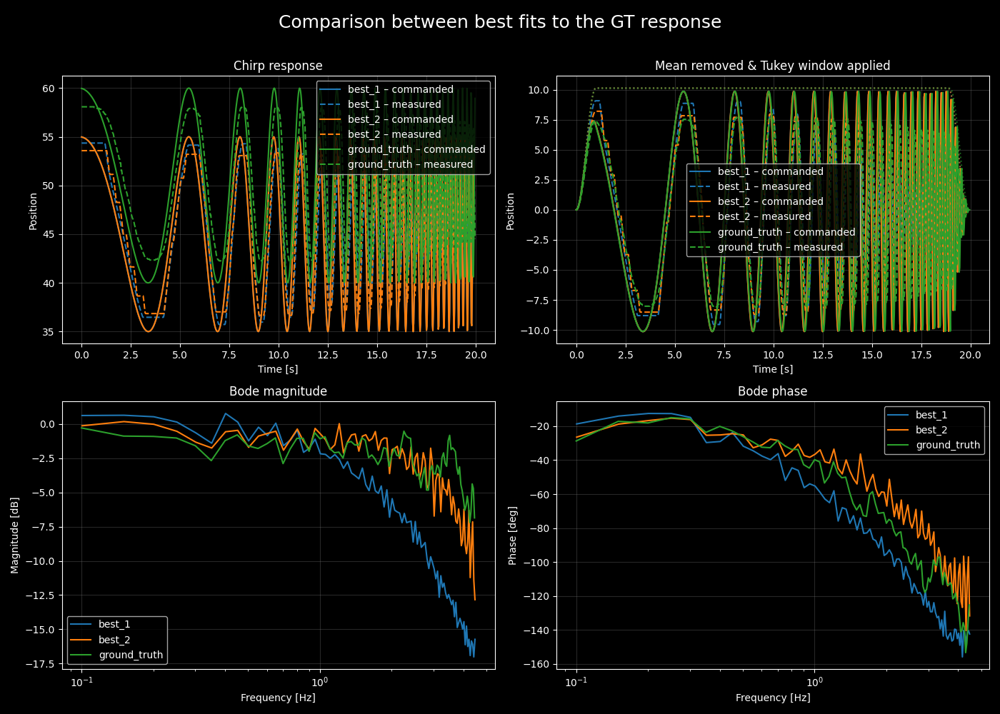
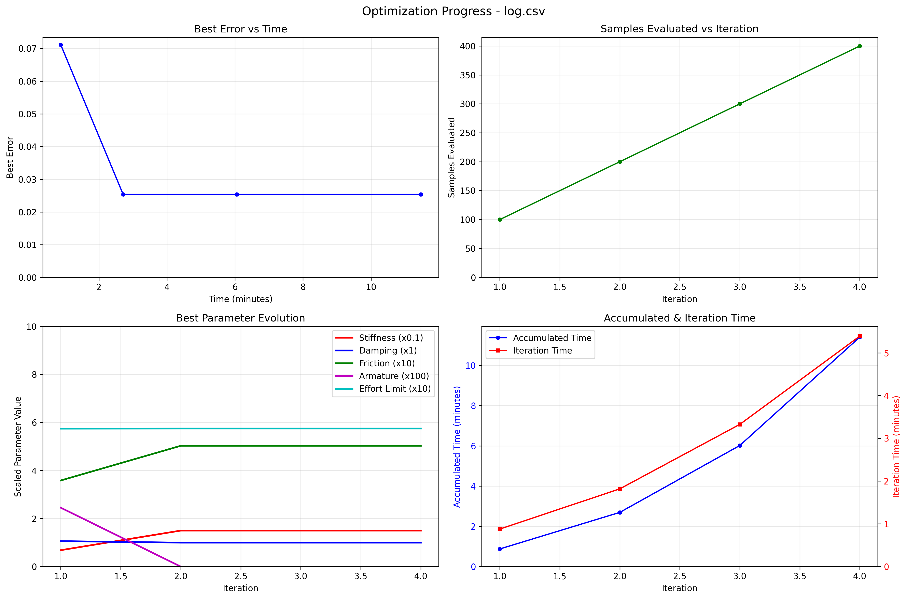

# Example output from optimization process

Ran the characterization for the index MCP flexion joint (set `max_freq` to 4.5 to avoid instability that was seen around 5 Hz)

```bash
python optimization.py \
        --ground_truth 202506_collected_realworld_data/chirp_index_mcp_20250606_170356_ctrl40Hz_20.0s_0.1-5.0Hz_10deg.csv \
        --joint_name root2index_pp --max_freq 4.5
```

you can see the FRF of just the GT data with
```bash
python plot_chirp_utils.py 202506_collected_realworld_data/chirp_index_mcp_20250606_170356_ctrl40Hz_20.0s_0.1-5.0Hz_10deg.csv --labels real --show --max_freq 4.5
```


The optimizer finds a better fit to GT over time



